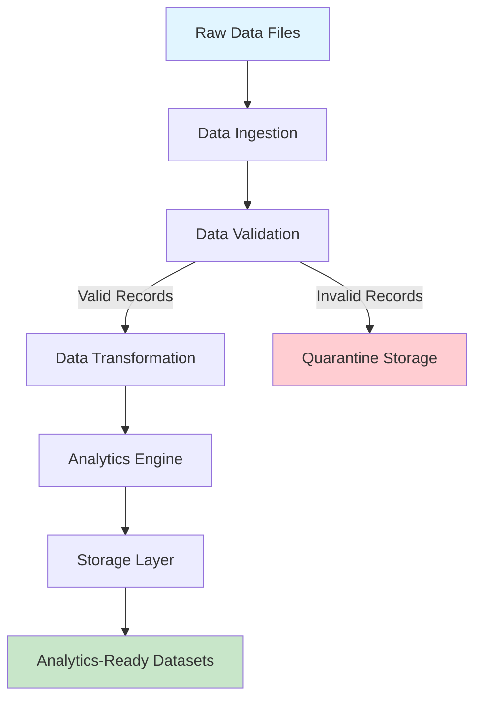
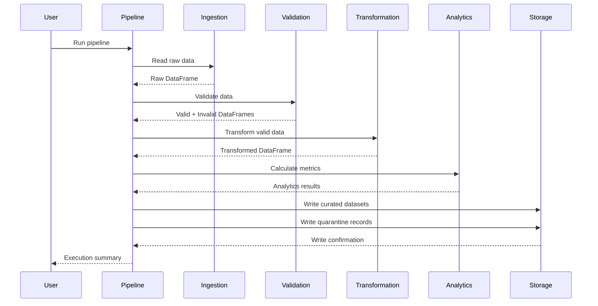

# Architecture Documentation

## System Overview

The PySpark Data Engineering Pipeline is a batch processing system designed to transform raw business data into validated, analytics-ready datasets. The architecture follows a modular design with clear separation of concerns across ingestion, validation, transformation, analytics, and storage components.

## High-Level Architecture



## Component Architecture

### 1. Data Ingestion

**Purpose**: Read raw data files into Spark DataFrames

**Responsibilities**:
- Read CSV files with optional schema enforcement
- Read JSON files with schema validation
- Read entire directories with multiple files
- Handle file existence checks
- Log record counts for auditing

**Input**: File paths (CSV, JSON, Parquet)
**Output**: Spark DataFrames

### 2. Data Validation

**Purpose**: Ensure data quality and separate valid from invalid records

**Responsibilities**:
- Schema validation (required columns, data types)
- Null value threshold checking
- Duplicate detection and removal
- Date format validation
- Business rule validation (positive quantities, price consistency)
- Quarantine record creation with error metadata

**Input**: Raw DataFrames
**Output**: Valid DataFrames, Invalid DataFrames, Quarantine DataFrames

### 3. Data Transformation

**Purpose**: Clean and enrich data for downstream analytics

**Responsibilities**:
- Text cleaning (trim, uppercase)
- Date standardization
- Derived column calculation (year, month, day)
- Revenue metric calculation
- Dataset joining (sales + customers)
- Additional derived columns

**Input**: Valid DataFrames
**Output**: Transformed DataFrames

### 4. Analytics Engine

**Purpose**: Calculate business metrics and aggregations

**Responsibilities**:
- Revenue by region
- Revenue by product
- Monthly trends
- Customer metrics
- Summary metrics (total orders, revenue, customers, products)
- Comprehensive report generation

**Input**: Transformed DataFrames
**Output**: Analytics DataFrames and metrics dictionaries

### 5. Storage Layer

**Purpose**: Persist processed data to storage backends

**Responsibilities**:
- Write to local filesystem
- Write to HDFS (when configured)
- Parquet format output
- CSV format output
- Partitioned output support
- Directory creation
- Quarantine record storage

**Input**: Analytics DataFrames
**Output**: Persistent data files

## Data Flow Diagram



## Schema Design

### Sales Schema

```python
StructType([
    StructField("order_id", StringType(), nullable=False),
    StructField("customer_id", StringType(), nullable=False),
    StructField("product_id", StringType(), nullable=False),
    StructField("product_name", StringType(), nullable=False),
    StructField("category", StringType(), nullable=True),
    StructField("quantity", IntegerType(), nullable=False),
    StructField("unit_price", DecimalType(10, 2), nullable=False),
    StructField("total_price", DecimalType(10, 2), nullable=False),
    StructField("order_date", DateType(), nullable=False),
    StructField("region", StringType(), nullable=True),
    StructField("payment_method", StringType(), nullable=True),
])
```

### Customer Schema

```python
StructType([
    StructField("customer_id", StringType(), nullable=False),
    StructField("customer_name", StringType(), nullable=False),
    StructField("email", StringType(), nullable=True),
    StructField("signup_date", DateType(), nullable=False),
    StructField("region", StringType(), nullable=True),
    StructField("customer_segment", StringType(), nullable=True),
])
```

### Quarantine Schema

```python
StructType([
    StructField("original_data", StringType(), nullable=False),
    StructField("error_type", StringType(), nullable=False),
    StructField("error_message", StringType(), nullable=False),
    StructField("timestamp", TimestampType(), nullable=False),
    StructField("source_file", StringType(), nullable=False),
])
```

## Storage Architecture

### Local Filesystem Mode

```
data/
├── sample/              # Input data
│   ├── sample_sales.csv
│   └── sample_customers.csv
├── output/              # Curated datasets
│   ├── sales_curated/
│   ├── revenue_by_region/
│   ├── revenue_by_product/
│   ├── monthly_trends/
│   └── customer_metrics/
└── quarantine/          # Invalid records
    └── quarantine_records/
```

### HDFS Mode

```
hdfs://namenode:port/
├── input/               # Input data
├── output/              # Curated datasets
└── quarantine/          # Invalid records
```

## Error Handling Strategy

### Validation Errors

1. **Schema Errors**: Missing required columns → Quarantine with SCHEMA_ERROR
2. **Date Errors**: Invalid date formats → Quarantine with DATE_ERROR
3. **Business Rule Errors**: Negative quantities, price mismatches → Quarantine with BUSINESS_RULE_ERROR

### Processing Errors

1. **File Not Found**: Raise FileNotFoundError with clear message
2. **Invalid Configuration**: Raise ValueError with configuration details
3. **Spark Errors**: Log full stack trace, return FAILED status

### Recovery Behavior

- Pipeline continues with valid records even if some records fail validation
- Quarantine records are written separately for investigation
- Failed validation steps are logged with detailed error messages
- Summary metrics track both successful and failed records

## Spark Configuration

### Session Configuration

```python
SparkSession.builder \
    .master(config.master)              # local[*] for local, yarn for cluster
    .appName(config.app_name)           # Application name
    .config("spark.driver.memory", "2g") # Driver memory
    .config("spark.executor.memory", "2g") # Executor memory
    .config("spark.sql.adaptive.enabled", "true") # Adaptive query execution
    .config("spark.sql.adaptive.coalescePartitions.enabled", "true")
```

### Adaptive Query Execution

- Enabled for automatic optimization
- Coalesces partitions to reduce small file problem
- Improves performance for variable-size datasets

## Idempotency Design

The pipeline is designed to be idempotent:

1. **Overwrite Mode**: Output uses `overwrite` mode by default
2. **Duplicate Removal**: Duplicate records are removed during validation
3. **Deterministic Output**: Same input produces same output
4. **No Side Effects**: No external system modifications beyond storage writes

## Scalability Considerations

### Local Mode

- Suitable for datasets up to ~10GB
- Uses local[*] to utilize all CPU cores
- Memory-limited by available RAM

### Cluster Mode (Future)

- Would use YARN or Kubernetes
- Scales to TB-scale datasets
- Requires cluster configuration

### Partitioning Strategy

Current: No partitioning (simple mode)
Future improvements:
- Partition by date for time-series queries
- Partition by region for regional analytics
- Partition by customer_id for customer-specific queries

## Monitoring and Observability

### Logging

- Structured logging with timestamps
- Log levels: DEBUG, INFO, WARNING, ERROR
- Component-level logging for debugging
- Record count logging at each stage

### Metrics

Pipeline tracks:
- Input record count
- Valid record count
- Invalid record count
- Quarantine record count
- Output record count
- Execution time (via logs)

## Security Considerations

- No credentials in code (use environment variables)
- Input validation prevents injection attacks
- File access restricted to configured directories
- No document content logging (privacy)

## Performance Characteristics

### I/O Bound Operations

- Reading: Parquet > CSV (columnar format)
- Writing: Parquet compression reduces storage
- Network: HDFS adds network latency

### CPU Bound Operations

- Validation: Schema checks, business rules
- Transformation: String operations, date parsing
- Analytics: Aggregations, joins

### Optimization Opportunities

1. Cache frequently used DataFrames
2. Use broadcast joins for small lookup tables
3. Partition data by query patterns
4. Use column pruning for selective reads
