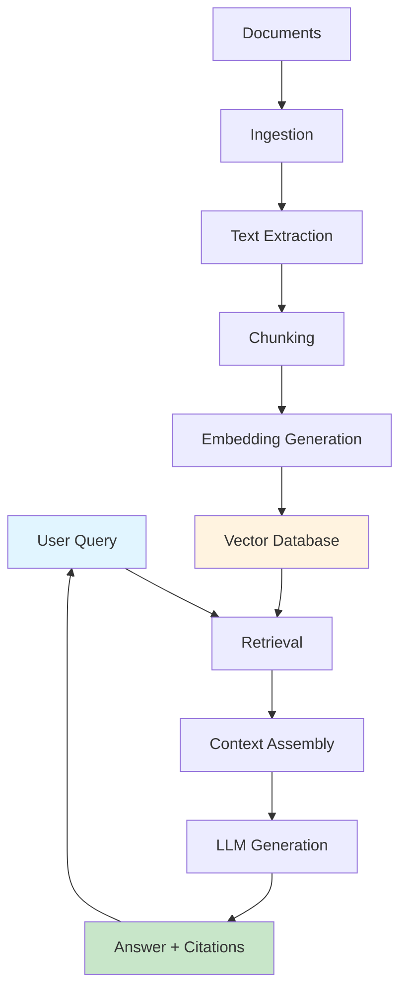
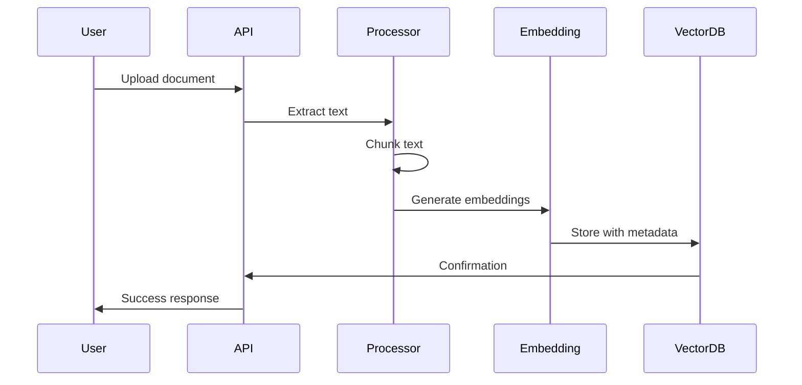
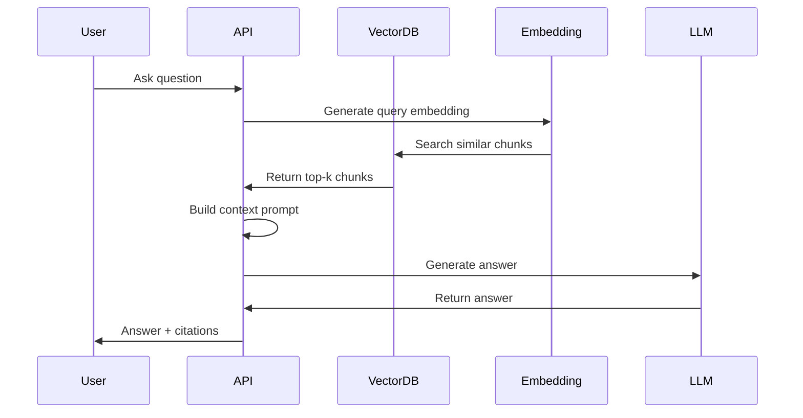

# Architecture Documentation

## System Overview

The Enterprise RAG Assistant is a document-grounded AI system that answers questions using uploaded documents. The architecture follows a modular design with clear separation between document processing, embedding generation, vector storage, retrieval, and answer generation.

## High-Level Architecture



## Component Architecture

### 1. Document Processor

**Purpose**: Extract text from documents and split into chunks

**Responsibilities**:
- Read PDF, TXT, and Markdown files
- Extract text with page metadata
- Validate file size
- Split text into chunks with overlap
- Preserve metadata (source, page, chunk_id)

**Input**: File paths
**Output**: Chunks with text and metadata

### 2. Embedding Manager

**Purpose**: Generate vector embeddings for text

**Responsibilities**:
- Load sentence-transformer model
- Generate embeddings for document chunks
- Generate embeddings for queries
- Handle CPU/GPU device configuration

**Input**: Text strings
**Output**: Embedding vectors (list of floats)

### 3. Vector Store

**Purpose**: Store and retrieve embeddings

**Responsibilities**:
- Initialize ChromaDB persistent client
- Add documents with embeddings
- Semantic search with cosine similarity
- Manage collection lifecycle
- Return top-k results with scores

**Input**: Embeddings, queries
**Output**: Relevant chunks with similarity scores

### 4. LLM Manager

**Purpose**: Generate answers using LLM

**Responsibilities**:
- Support multiple LLM providers (OpenAI, Mock)
- Handle API interactions
- Provide fallback to mock mode
- Generate responses from prompts

**Input**: Prompts with context
**Output**: Generated text responses

### 5. RAG Orchestrator

**Purpose**: Coordinate the RAG pipeline

**Responsibilities**:
- Ingest documents end-to-end
- Process queries with retrieval and generation
- Manage component lifecycle
- Provide status information
- Handle errors gracefully

**Input**: Documents, queries
**Output**: Answers with citations

### 6. API Layer

**Purpose**: Expose RAG functionality via REST API

**Responsibilities**:
- Health check endpoint
- Document ingestion endpoint
- Query endpoint
- Status endpoint
- Clear index endpoint
- Input validation and error handling

**Input**: HTTP requests
**Output**: JSON responses

### 7. UI Layer

**Purpose**: Provide interactive web interface

**Responsibilities**:
- Document upload interface
- Query interface
- Display answers with citations
- Show index status
- Configuration display

**Input**: User interactions
**Output**: Web interface

## Data Flow

### Ingestion Flow



### Query Flow



## Schema Design

### Chunk Metadata Schema

```python
{
    "source": str,        # Source filename
    "page": int,         # Page number
    "chunk_id": int      # Chunk index within document
}
```

### Search Result Schema

```python
{
    "text": str,         # Chunk text
    "metadata": dict,    # Chunk metadata
    "score": float,      # Similarity score
    "id": str           # Unique chunk ID
}
```

### Query Response Schema

```python
{
    "status": str,       # success, no_context, error
    "answer": str,       # Generated answer
    "sources": list,     # Source citations
    "context_used": int  # Number of chunks used
}
```

## Storage Architecture

### ChromaDB Structure

```
data/index/
└── chroma.sqlite3       # ChromaDB persistent storage
```

### Collection Schema

- **Name**: documents
- **Embedding Space**: cosine
- **Metadata**: Stored with each chunk
- **Persistence**: SQLite-based

## Error Handling Strategy

### Document Ingestion Errors

1. **File Size Error**: Reject files exceeding size limit
2. **Format Error**: Reject unsupported file formats
3. **Extraction Error**: Log error and return failure status
4. **Storage Error**: Log error and return failure status

### Query Errors

1. **No Documents**: Return "no_context" status with helpful message
2. **Retrieval Error**: Log error and return error status
3. **LLM Error**: Fallback to mock mode if API fails
4. **Empty Query**: Reject with validation error

## Security Considerations

### Input Validation

- File type validation (PDF, TXT, MD only)
- File size limits
- Query string validation
- Path traversal prevention

### Data Privacy

- No document logging
- Temporary file cleanup
- Secure storage (ChromaDB)
- Environment variable for API keys

### Prompt Injection

- Warning in documentation
- No sanitization in current implementation
- Future: Content filtering and prompt injection detection

## Performance Characteristics

### Embedding Generation

- Model: sentence-transformers/all-MiniLM-L6-v2
- Speed: ~1000 chunks/second on CPU
- Memory: ~500MB for model

### Vector Search

- Index size: Linear with number of chunks
- Search speed: <100ms for 10k chunks
- Scalability: Up to ~100k chunks on single machine

### LLM Generation

- Mock mode: Instant
- OpenAI mode: ~1-3 seconds depending on model and context length

## Scalability Considerations

### Current Limitations

- Single-machine ChromaDB
- CPU-only embedding generation
- No distributed processing
- No caching

### Scaling Strategies

1. **Horizontal Scaling**: Use distributed vector database (Weaviate, Pinecone)
2. **GPU Acceleration**: Use GPU for embedding generation
3. **Caching**: Cache embeddings and query results
4. **Batch Processing**: Process multiple documents in parallel
5. **Load Balancing**: Multiple API instances behind load balancer
