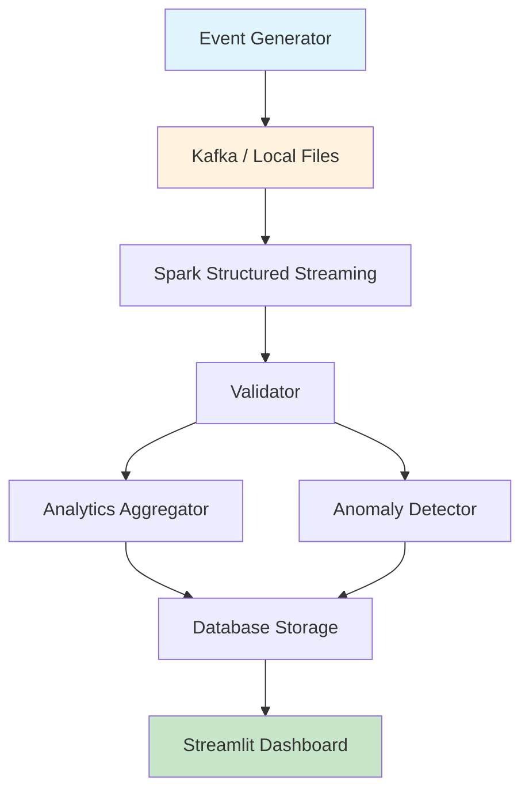
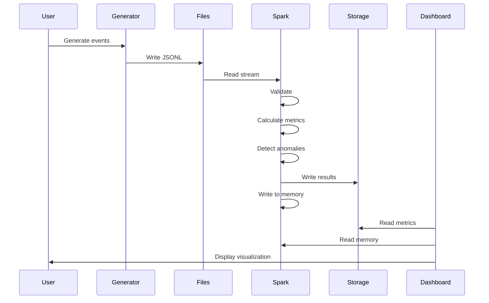

# Architecture Documentation

## System Overview

The Real-Time Streaming Analytics Platform is a streaming data processing system that ingests transaction events, processes them in real-time, calculates windowed analytics, detects anomalies, and presents results through a dashboard.

## High-Level Architecture



## Component Architecture

### 1. Event Generator

**Purpose**: Generate synthetic transaction events

**Responsibilities**:
- Generate realistic transaction events
- Support deterministic generation with seed
- Generate anomalous events for testing
- Save events to JSONL format

**Input**: Generation parameters (count, seed)
**Output**: Event files (JSONL)

### 2. Stream Processor

**Purpose**: Orchestrate streaming data processing

**Responsibilities**:
- Create and manage Spark session
- Create input stream (local files or Kafka)
- Coordinate validation, analytics, and anomaly detection
- Manage streaming queries
- Handle graceful shutdown

**Input**: Streaming configuration
**Output**: Processing results in memory and storage

### 3. Validator

**Purpose**: Validate and clean streaming events

**Responsibilities**:
- Schema validation (required columns)
- Null value detection
- Amount validation (must be positive)
- Duplicate detection (by event_id)
- Timestamp parsing

**Input**: Raw event DataFrame
**Output**: Validated DataFrame

### 4. Analytics Aggregator

**Purpose**: Calculate windowed analytics

**Responsibilities**:
- Calculate overall metrics (count, total, average)
- Calculate category-level metrics
- Calculate status-level metrics
- Support configurable window sizes

**Input**: Validated event DataFrame
**Output**: Metrics DataFrames

### 5. Anomaly Detector

**Purpose**: Detect anomalous transactions

**Responsibilities**:
- Calculate statistical thresholds (mean + multiplier × std_dev)
- Flag transactions exceeding threshold
- Provide anomaly reasons
- Support configurable threshold multiplier

**Input**: Event DataFrame
**Output**: DataFrame with anomaly flags

### 6. Database Storage

**Purpose**: Persist processed data

**Responsibilities**:
- Write metrics to database
- Write anomalies to database
- Read metrics for dashboard
- Support SQLite (local) and PostgreSQL
- Fallback to Parquet if database unavailable

**Input**: DataFrames to persist
**Output**: Persisted data

### 7. Dashboard

**Purpose**: Visualize analytics in real-time

**Responsibilities**:
- Display transaction metrics
- Display detected anomalies
- Display category analytics
- Support data refresh

**Input**: Database or memory data
**Output**: Web interface

## Data Flow

### Local Mode Flow



## Schema Design

### Transaction Event Schema

```python
StructType([
    StructField("event_id", StringType(), nullable=False),
    StructField("timestamp", TimestampType(), nullable=False),
    StructField("user_id", StringType(), nullable=False),
    StructField("amount", DoubleType(), nullable=False),
    StructField("category", StringType(), nullable=False),
    StructField("payment_method", StringType(), nullable=True),
    StructField("status", StringType(), nullable=False),
])
```

### Metrics Schema

```python
StructType([
    StructField("window_start", TimestampType(), nullable=False),
    StructField("window_end", TimestampType(), nullable=False),
    StructField("event_count", IntegerType(), nullable=False),
    StructField("total_amount", DoubleType(), nullable=False),
    StructField("avg_amount", DoubleType(), nullable=False),
    StructField("category", StringType(), nullable=True),
])
```

### Anomaly Schema

```python
StructType([
    StructField("event_id", StringType(), nullable=False),
    StructField("timestamp", TimestampType(), nullable=False),
    StructField("user_id", StringType(), nullable=False),
    StructField("amount", DoubleType(), nullable=False),
    StructField("category", StringType(), nullable=False),
    StructField("reason", StringType(), nullable=False),
    StructField("threshold", DoubleType(), nullable=False),
])
```

## Storage Architecture

### Local Mode (SQLite/Parquet)

```
data/
├── input/                    # Input event files
│   └── sample_events.jsonl
├── output/                   # Processed data
│   ├── metrics/
│   └── anomalies/
├── checkpoint/               # Spark checkpoints
└── analytics.db              # SQLite database (optional)
```

### Docker Mode (PostgreSQL)

```
PostgreSQL Container:
├── metrics table
└── anomalies table
```

## Windowing Strategy

### Tumbling Windows

- Fixed-size, non-overlapping windows
- Default: 1 minute
- Aggregations per window

### Window Metrics

- **Overall**: Total events, total amount, average amount
- **By Category**: Breakdown by transaction category
- **By Status**: Breakdown by transaction status

## Error Handling Strategy

### Validation Errors

- **Null Values**: Filter out records with null required fields
- **Invalid Amounts**: Filter out non-positive amounts
- **Duplicates**: Remove duplicates based on event_id
- **Invalid Timestamps**: Filter out records that can't be parsed

### Processing Errors

- **Spark Errors**: Log error, stop stream gracefully
- **Storage Errors**: Fallback to local Parquet storage
- **Anomaly Detection**: Handle zero std_dev gracefully

## Performance Characteristics

### Processing Latency

- **Local Mode**: Sub-second for small batches
- **Window Aggregation**: Depends on window size
- **Anomaly Detection**: O(n) per batch

### Throughput

- **Local Files**: Limited by disk I/O
- **Kafka**: Higher throughput (not implemented)

## Scalability Considerations

### Current Limitations

- Single-machine Spark
- No distributed processing
- Local filesystem only
- No partitioning

### Scaling Strategies

1. **Cluster Mode**: Deploy Spark on YARN/Kubernetes
2. **Kafka Scaling**: Multiple partitions, consumer groups
3. **Database Scaling**: Connection pooling, read replicas
4. **Window Optimization**: Tune window size for use case
